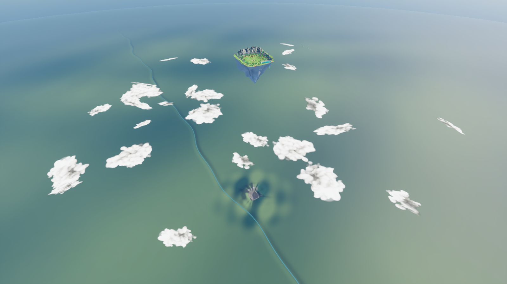
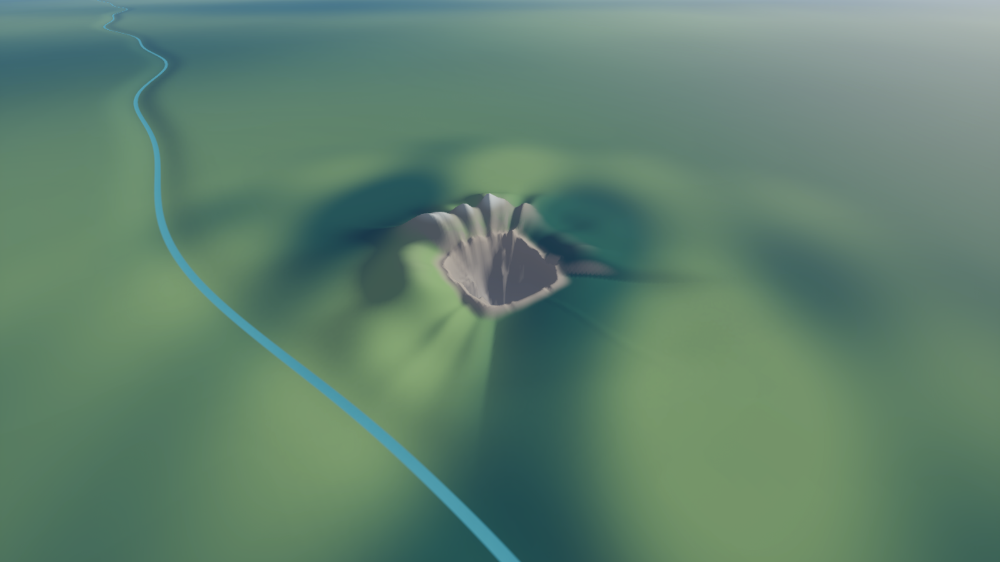

# Continental birthplace aligned to the island — v16

The oversized independent continental mountain crescent has been replaced by a compact continuation sampled from the actual island's current terrain. Heights around the island rim determine the surrounding relief: higher north, west and east sectors, with a low southern opening. The nearby river and land colour variation now use a smaller regional scale.

The reduced hollow remains centered below the island, with a 406 metre core. Its outer transition is tightened to approximately 528 metres. Surrounding ridges sit close to that footprint instead of several kilometres away. The distant continent remains broad enough to fill the horizon, but the former giant local ranges have been removed.

Island terrain, underside, settlement, farm, lake and roads are unchanged. This is a scenic scale match rather than a literal full-size reconstruction; it retains the smaller apparent birthplace requested in v15.

Map: `/Game/IsekaiVillage/AdventureWorld/Maps/Map_AnimeAdventure`.

Recovery map: `Saved/WorldBackups/BeforeAlignedOrigin_v16`. Previous continent assets remain available as v15.
