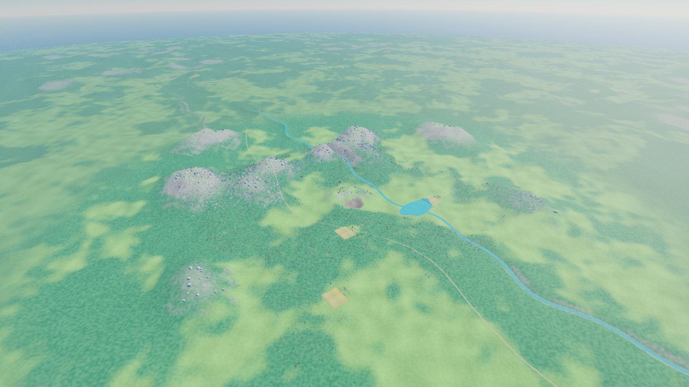
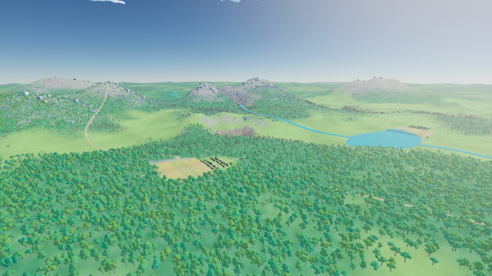
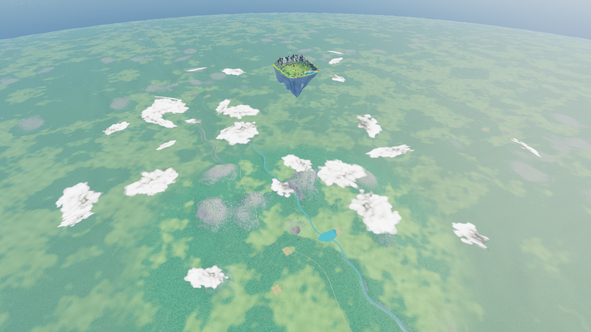

# Continental river valley and birthplace — v17

Map: `/Game/IsekaiVillage/AdventureWorld/Maps/Map_AnimeAdventure`.

This replaces the barren v16 background with a dressed scenic landscape beneath the floating island. The main valley includes connected woodlands, mountain foothills, open meadows, a lake with an irregular shore, a river, roads and three farming hamlets. The primary dressed area is approximately six kilometres across; land continues into the distant horizon.

The small extraction basin remains directly beneath the island. Its pinched walls have been replaced by a broad, irregular rock bowl with exposed outcrops and debris around the rim. The core is approximately 450 metres wide and around 170 metres deep, deliberately small in the distant view. It is a scenic interpretation rather than a full-scale negative of the island.

## Reused project assets

- 46,000 native tree instances from SoStylized: two oak variants and pine.
- 2,200 rock clusters and 185 larger outcrops using SoStylized Spire rocks.
- 108 distant houses using the two Advanced Village Pack house meshes, with project-owned materials for visibility at this elevation.
- Separate lake and river surface geometry, with project-owned stylized water material.

The ground atlas differentiates woodland canopy, meadow, stone, shore, paths and crop fields. It uses a 2048-pixel RGBA texture; the earlier 2049-pixel import failed to display correctly and is no longer used by the material.

The original asset packs and floating island terrain, repaired underside, village, farm, lake and routes are unchanged. This is dressed background scenery; it does not add a playable continental region, settlement simulation, navigation or interactive farming. Packaged performance and full character traversal have not been tested.

All 18 island terrain samples, 768 perimeter traces and 96 underside traces passed again after the continental dressing was added. These checks establish that the existing island was preserved; they do not certify continental gameplay or production performance.

Recovery map: `Saved/WorldBackups/BeforeLivingWorld_v17`. Previous continental mesh/material remain as v16 assets. Main mesh: `SM_IV_LivingContinent_v17`; material: `M_IV_LivingContinent_Final17`. Details: `Saved/living_continent_result.json` and `Saved/continent_details_result.json`.
