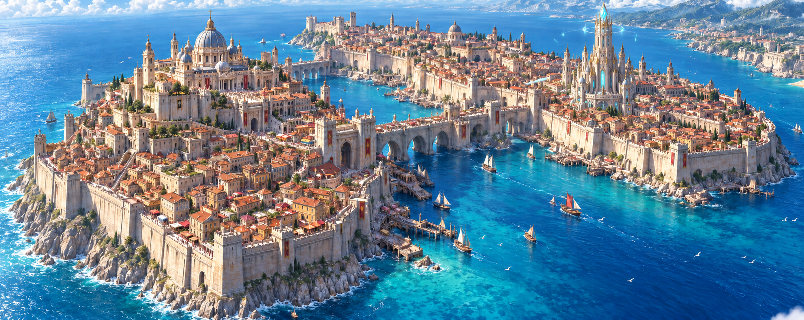

# Gosain — approved finished visual target

17 October 2026. The user explicitly approved the generated two-island Vatican-inspired city, then approved the revision adding a giant magic tower on the other island, and requested implementation.

This is concept art, not an Unreal screenshot. It supersedes speculative architectural interpretations and the rejected arcade/rafter designs. Preserve the existing island outlines while translating the image's architecture and density to the actual map.

- Two sea islands, both fully enclosed by immense thick pale masonry defenses, joined by a monumental fortified stone bridge.
- Dense warm ivory/ochre masonry districts with terracotta roofs; connected irregular blocks, narrow streets, alleys and small courts. Fill the islands to the inner wall streets without a vacant grass belt.
- Broad occupied terraces rise toward the capital summit. Basilica, palace/castle and civic architecture dominate the capital skyline.
- The other island has a giant elegant magic tower: pale stone, gold accents, luminous cyan crown and restrained arcane ring. It grows from the city rather than standing isolated in a clearing.
- Worn stone, shops, awnings, planted pockets, stairs, retaining walls and people convey centuries of urban growth.
- Preserve the approved image's balance. Do not substitute sparse cottages, exposed rafters, Venetian canals, repeated formal courtyard blocks or modern towers.

## Guided implementation order

1. Complete and verify Gosain44: extend city terrain to walls and coordinate wall/bridge elevations.
2. Establish second-island magic tower silhouette and material language in native Unreal; verify multiple views. Exterior landmark first, interiors/gameplay later.
3. Engineer the main streets, gate approaches and summit ramps on current terrain; reserve the landmark footprints.
4. Author one representative dense connected district with terracotta roofs and masonry details fitted to these streets. Inspect native close and distant views before expansion.
5. Expand varied districts across BOTH islands to the walls, replacing temporary cottages locally with recoverable backups.
6. Complete summit basilica/palace, retaining architecture, gatehouses and bridge detail.
7. Add market/service detail and restrained vegetation, then traversal, collision, navigation, performance and all-angle visual checks.

Do not claim the concept is implemented until those stages have actual native evidence. Keep El Ruhn and other regions unchanged. Record each completed stage and the next bounded task in the checkpoint.

Generated with the built-in image tool. Original approved edit prompt: preserve the two-island Gosain concept, add a giant pale limestone/ivory tapered magic tower on the farther/right island, articulated levels and buttresses, gold detailing, cyan magical windows and crystal-lit crown with a restrained floating arcane ring; preserve the left basilica, dense city, walls, bridge, sea, camera and lighting.
