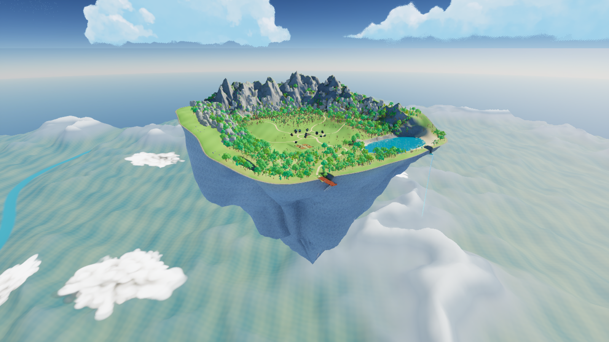
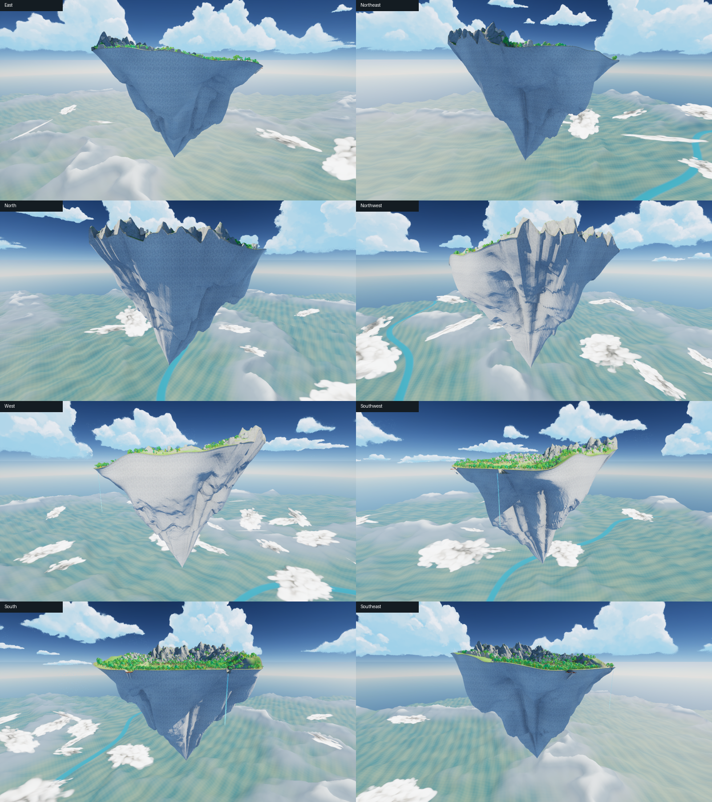
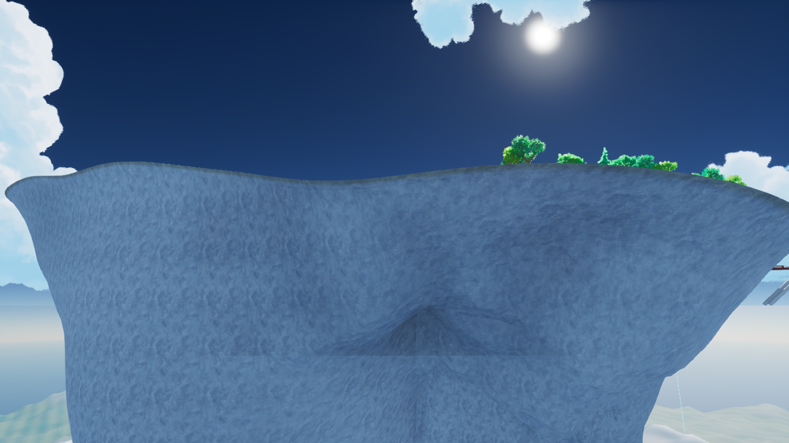

# Current island: repaired join and rock finish — v13

Map: `/Game/IsekaiVillage/AdventureWorld/Maps/Map_AnimeAdventure`.

This supersedes v12. The native terrain, shallow hill lip, village, farm, lake and roads are retained.

## Repaired

The v12 shoulder deformation also displaced the underside's top boundary. Measured offsets reached 24.70 metres, with 1,251 of 2,048 samples more than one metre from the Landscape edge. The previous interior topology and radial collision checks did not detect this perimeter mismatch.

The new mesh locks the join independently of the shoulder deformation. Four connected rings overlap beneath the native Landscape and wrap slightly beyond its edge. The hidden inner boundary is at normalized radius 0.992; the outer wrap is at 1.003. The exposed join is part of the same mesh as the underside.

Narrow lower creases were softened, small-scale relief fades near the tip, and the lower rings use fewer vertices to avoid thin fans of triangles. The main downward peak and asymmetric rock shoulders remain.

The underside now uses the existing SoStylized painted Spire colour texture projected at 45 metres, plus subtle normal detail at 18 metres. The material is a project-owned copy; original pack assets are unchanged.

## Verified

- All 768 perimeter coverage traces pass: 256 directions at three radii spanning the terrain/rock join.
- All 96 underside traces pass: 32 directions at three depths.
- No internal open edges or nonmanifold edges in the generated mesh. The only open boundary is the intentional inner edge buried beneath the Landscape.
- Fourteen Unreal views captured, including eight compass directions, below, above, overview, rim and close cliff/rear joins.
- Native terrain heights were not changed in this repair. Full character traversal and packaged-game performance were not tested.

Current mesh: `SM_IV_JoinedMountain_v13`; material: `M_IV_JoinedGeology_v13`. Validation: `Saved/join_validation.json`. Render list: `Saved/join_render_review.json`. Recovery copy: `Saved/WorldBackups/BeforeJoinRepair_v13`.
