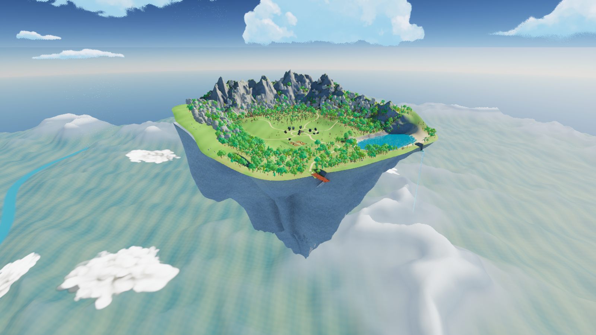
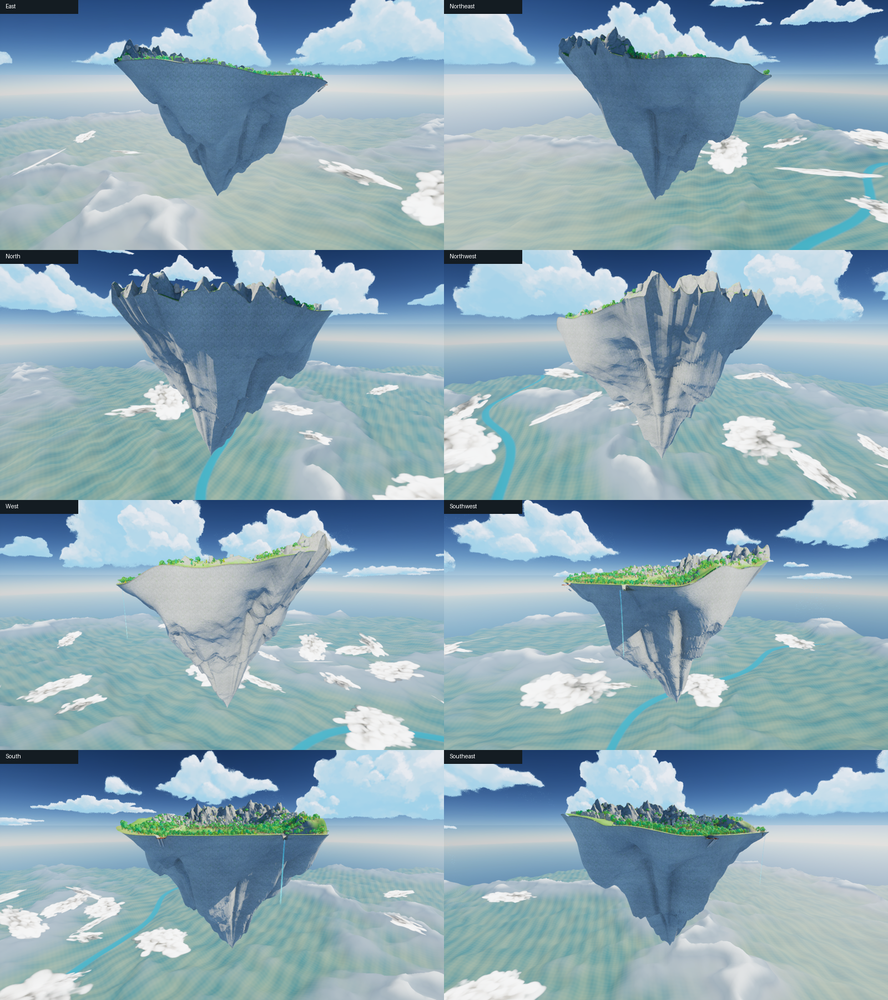
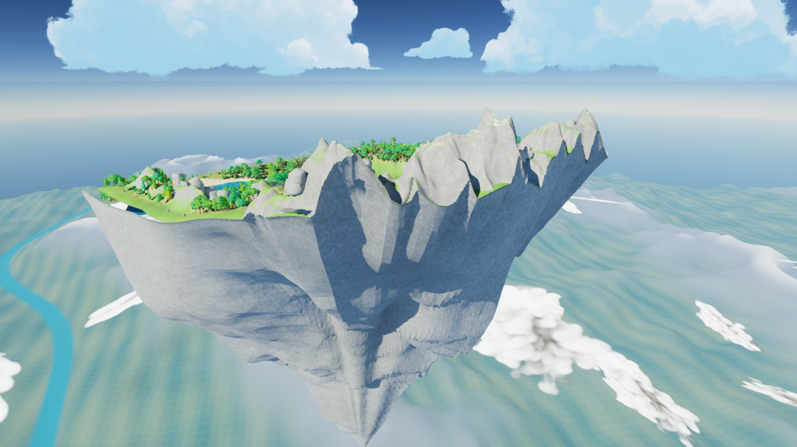
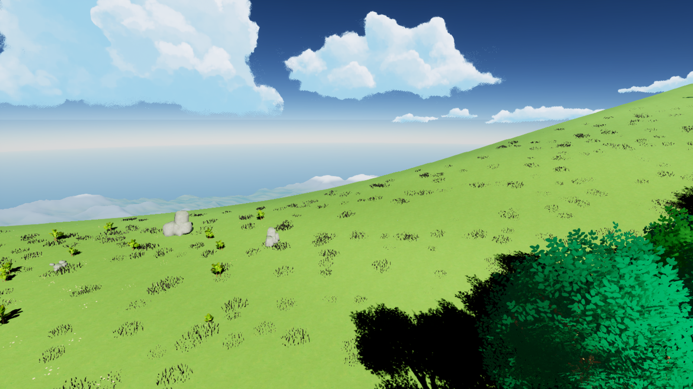

# Island refinement from all sides — v12

Saved map: `/Game/IsekaiVillage/AdventureWorld/Maps/Map_AnimeAdventure`.

This continues the shallow-dish / inverted-mountain direction. The playable Landscape heights, village, farm, paths, lake and dock remain unchanged from v11.

## Shape and edges

The underside is a single continuous inverted mountain, with an offset summit, unequal rock buttresses, branching ravines and angular fractures at several scales. Smooth procedural folds were replaced with broken planar relief. There are no separate floating boulders or repeated rock rings beneath it.

The terrain join now uses 2,048 perimeter samples rather than 160. The mesh contains 25,089 vertices and 48,128 triangles. Its only open boundary is the intended top seam against the native Landscape; there are no internal open or nonmanifold edges.

The broad shallow hill lip remains. Small, uneven vegetation and embedded-stone patches break up its bare surface while keeping the lake, waterfall and dock approaches clear. Added instances reuse existing SoStylized meshes: 3,400 grass patches, 650 flowers, 125 shrubs, 75 low rock clusters and 18 partly buried outcrops. Total foliage instances: 105,556. Shadows are disabled for the added grass and flower patches to avoid harsh close-range speckling.

## Surface treatment

The underside uses a dedicated world-projected material based on the existing SoStylized Classic rock texture. Broad variation and recessed-face shading replace the previous dense grain. The Landscape's rock projection now uses the same 95-metre scale; snow is limited to high, upward-facing caps instead of whitening whole mountain faces. Original pack assets are unchanged.

## Review and validation

- Fourteen actual Unreal views: eight compass directions, directly below, above, overview, inner rim, close cliff and rear mountain join.
- Forty-eight underside collision rays pass: sixteen directions at each of three depths.
- All eighteen native Landscape height/hole checks pass.
- Earlier v09, v10 and v11 undersides are hidden and have collision disabled.
- Full character traversal, packaged-game performance and arbitrary camera positions were not exhaustively tested. The angle review is a concrete sampling of the island, not a claim of guaranteed visual perfection.

Validation: `Saved/orbit_validation.json`. Render list: `Saved/orbit_after_review.json`. Recovery: `Saved/WorldBackups/BeforeOrbitRefine_v12`. Geometry source: `Saved/AdventureWorldSource/SM_IV_OrbitMountain_v12.obj`. Previous design and research: [v11 notes](Shallow_Dish_Inverted_Peak_v11.md).
