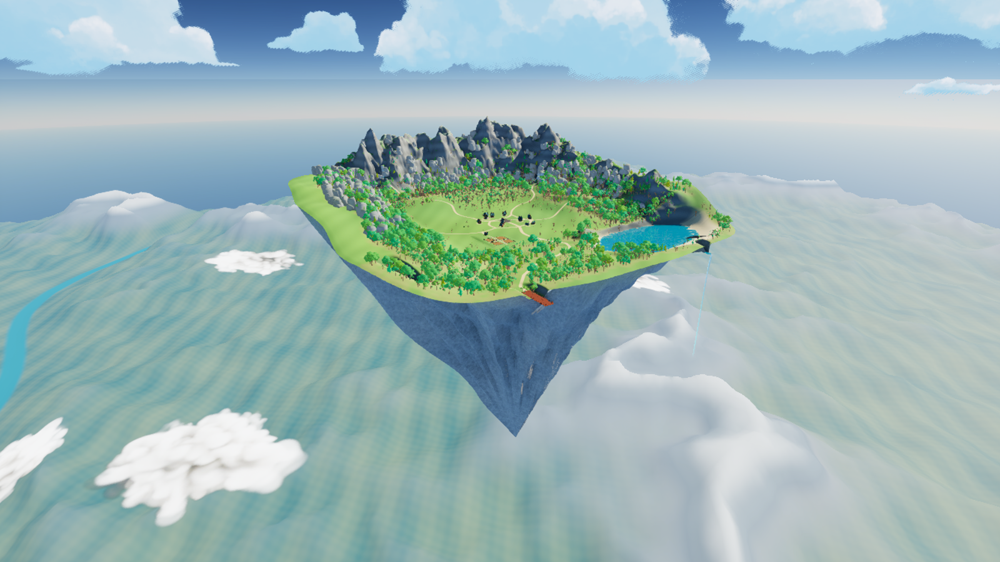
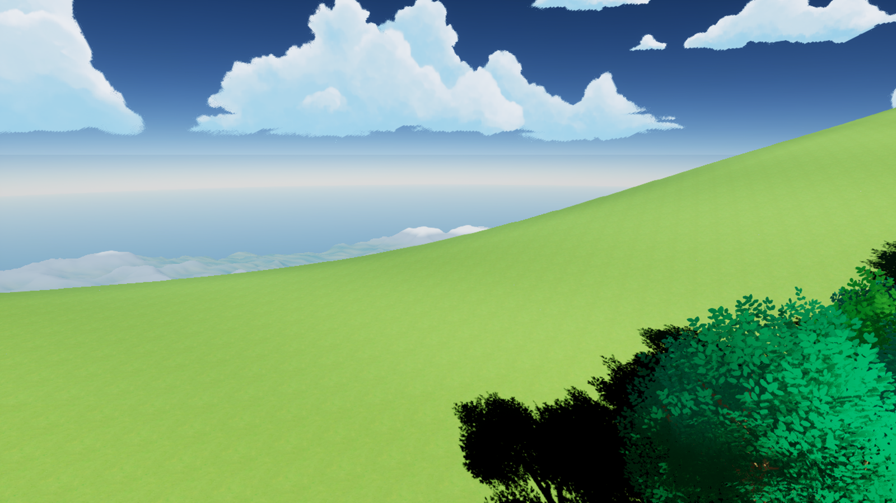
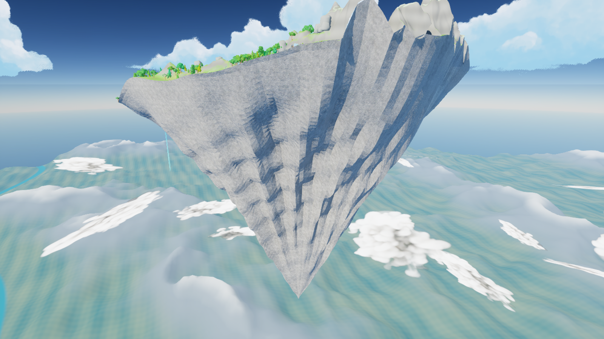

# Shallow dish and inverted mountain — v11

Current map: `/Game/IsekaiVillage/AdventureWorld/Maps/Map_AnimeAdventure`.

This revision implements the September 28 correction: a low hill lip around the native Landscape, and one mountain peak turned upside down. It supersedes the v09/v10 underside and tall rim treatments.

## Reference interpretation

[NPS cirques](https://www.nps.gov/articles/cirques.htm) explains bowl-shaped depressions and their lips. Only that cross-section concept is used here; the requested shallow dish does not require a steep glacial amphitheater.

[NPS arêtes and horns](https://www.nps.gov/articles/nunataksareteshorns.htm) describes pointed peaks with distinct ridges and broad faces. The underside has four unequal major ridges, subsidiary gullies and one offset downward summit, rather than a rounded shell covered in separate boulders.

## Implemented

- Broad, rounded earthen edge rise, generally 6–16 metres above its surrounding reference elevation. The eastern legacy coastal trough is filled into a continuous hillside. The northern mountain crescent remains.
- One continuous 19,680-triangle rock underside, ending at (-80, 38, -884) metres. Explicit facet normals preserve angular rock faces. Existing SoStylized-derived rock material is reused through a separate material instance.
- Native Landscape remains the playable top. An undercut underside requires a separate mesh; it is not a substitute for Landscape terrain.
- Previous v10 rock actors archived, hidden at component level and collision disabled. No new detached rock clusters.
- Vegetation regrounded after both height updates; 101,288 instances remain.
- Village and farm layout, lake, waterfall channel and airship dock retained.

## Verification

- 194,902 protected settlement height samples exactly match the v08 baseline.
- All 18 native Landscape collision/height checks pass, including farm, plaza, lake, dock, edge and outside-island holes.
- No old v10 rock components remain visible.
- Reviewed four actual Unreal renders: overview, underside, left hillside, reverse underside.
- Full character traversal and packaged-game performance were not tested in this art refinement.

Recovery copy: `Saved/WorldBackups/BeforeDishPeak_v11`. Validation: `Saved/dish_peak_validation.json`. Source: `Saved/AdventureWorldSource/height_dish_peak_v11.npy`, `IV_DishPeak_v11.r16`, `SM_IV_InvertedMountain_v11.obj`.

The apply scripts are session operations, not general-purpose idempotent regeneration tools: foliage adjustment requires the exact prior height file. Do not blindly rerun either apply script on the finished map.
