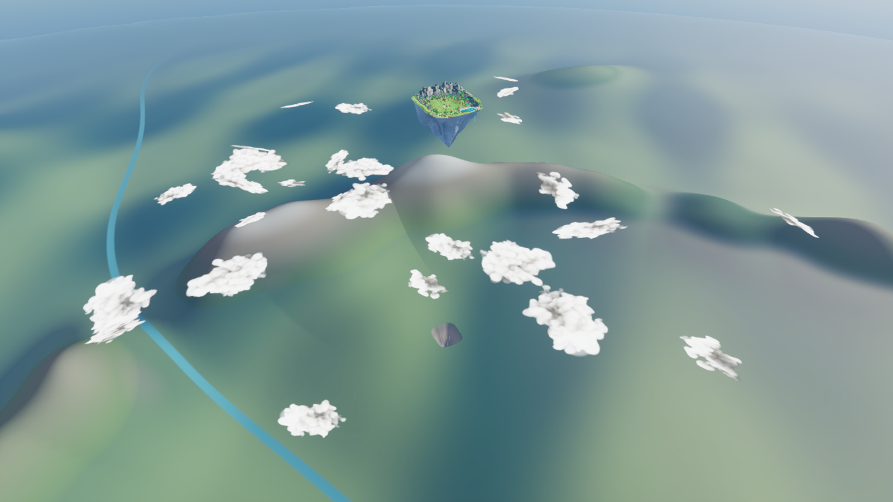

# Smaller continental hollow — v15

The hollow is reduced to 35% of its previous width (about 88% less footprint area). Its core is approximately 406 metres wide, with a roughly 751 metre disturbed transition. Depth is also reduced to keep the smaller opening proportionate. The exposed-rock material follows the smaller footprint.

This intentionally uses a smaller scenic footprint rather than a literal full-scale negative, following the user's visual correction. It remains directly below the island. The continent outside the original hollow is unchanged; island terrain, underside, village and roads are unchanged.

Map: `/Game/IsekaiVillage/AdventureWorld/Maps/Map_AnimeAdventure`.

Recovery map: `Saved/WorldBackups/BeforeSmallerOrigin_v15`. Previous continent mesh/material remain available as v14 assets.
