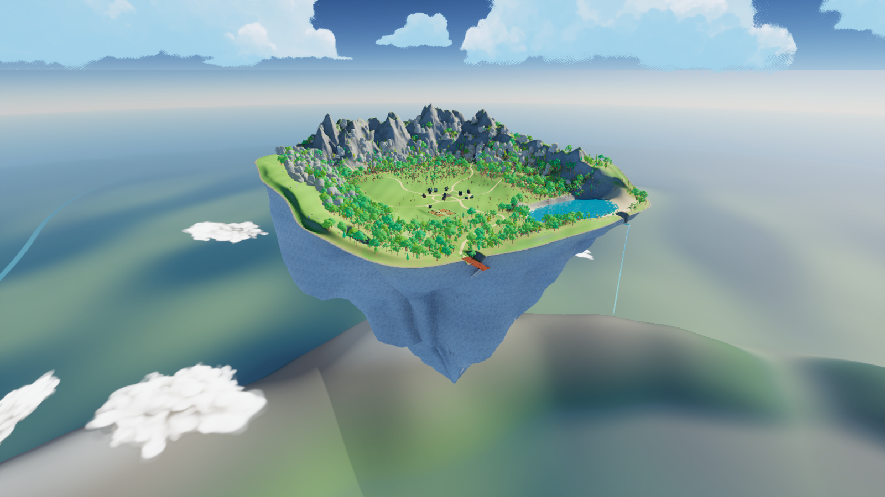
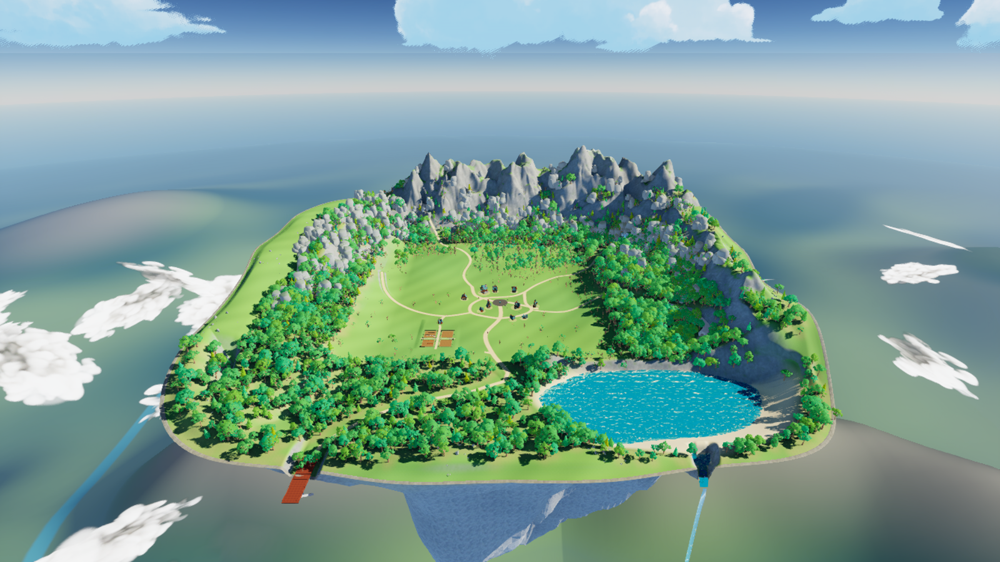
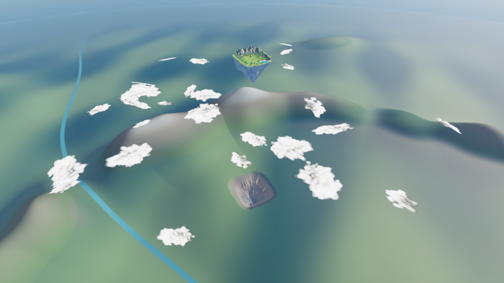
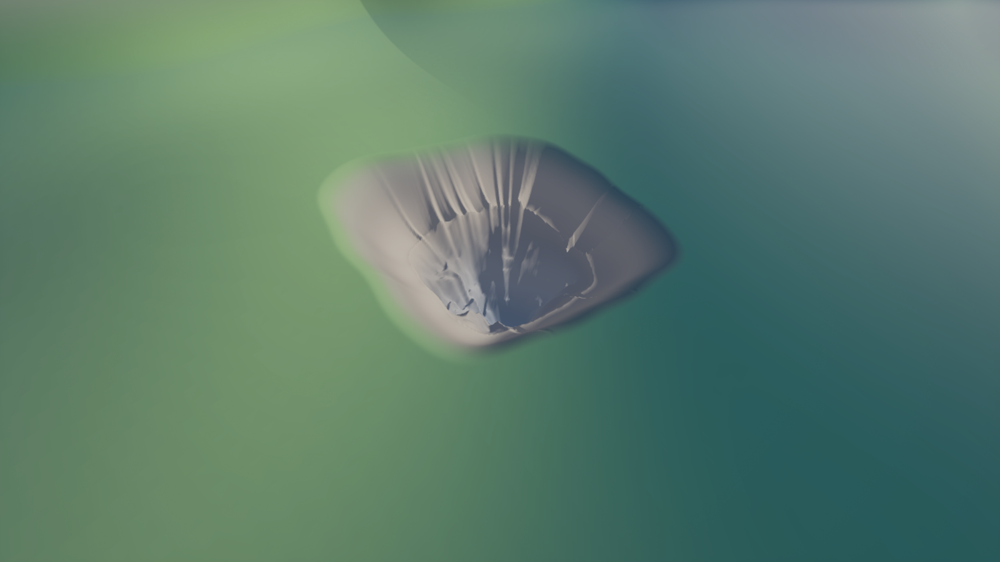

# Shallow valley rim and continental birthplace — v14

Map: `/Game/IsekaiVillage/AdventureWorld/Maps/Map_AnimeAdventure`.

The island now has uneven, broad hills along its inner perimeter. The largest additional rise is 17.23 metres. They frame the settlement as a shallow valley while preserving the level farm, construction area, lake, roads, dock approach and waterfall outlet. The outermost terrain heights remain identical to v13, preserving the repaired overlap with the underside.

The distant continent uses smooth regional slopes and a connected crescent of mountain ridges. A roughly 1.16 kilometre core hollow sits directly below the island, with a disturbed transition about 2.15 kilometres wide. Its core is sampled from the actual island underside at matching horizontal scale, so the missing land relates to the floating rock rather than being an unrelated circular crater. The surrounding regional crescent echoes the island's rear mountain arrangement. This is background scenery, not a second playable map.

Ground cover was adjusted to the raised terrain: 12,176 instances regrounded and 145 removed from steep scarps. The map retains 105,411 native foliage instances.

## Validation

- All 18 native terrain height/visibility samples pass, including the farm, plaza, lake, dock and new hills.
- All 768 perimeter coverage checks and 96 underside checks pass after the terrain change.
- All 194,902 protected town height samples remain unchanged; the repaired outer join is unchanged.
- Full character traversal and packaged-game performance remain untested.

The original asset packs are unchanged. Recovery copy: `Saved/WorldBackups/BeforeValleyAndOrigin_v14`. Source measurements: `Saved/AdventureWorldSource/valley_origin_v14.json`. Native checks: `Saved/valley_native_validation.json`; join checks: `Saved/join_validation.json`.

